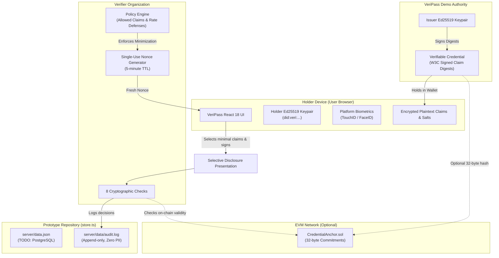

# VERIPASS &bull; Self-Sovereign Digital Passport

> **⚠️ PROTOTYPE DEMONSTRATION DISCLAIMER**  
> VeriPass is an educational and technical research prototype demonstrating self-sovereign identity, selective disclosure, anti-honeypot defenses, and privacy-preserving blockchain anchoring.  
> It operates with **fictional demo data only**. **DO NOT** input real government-issued passports, personal biometric information, or sensitive financial documents.

---

## 1. What is VeriPass?

**VERIPASS** is a privacy-first, self-sovereign digital passport application. Traditional digital identity systems force users to disclose complete identity records to every verifier (hotels, airlines, car rentals, border checks), creating honeypots of personal data vulnerable to mass surveillance, data scraping, and breaches.

VeriPass re-engineers this model using:
- **Decentralized Identifiers (DIDs):** Formed as `did:veri:<base64url of Ed25519 public key>`, controlled directly by the user.
- **Salted Cryptographic Commitments:** Credential documents hold only `sha256(salt:claimName:claimValue)` digests. Authorities never broadcast plaintext claims.
- **Data-Minimizing Selective Disclosure:** Holders reveal strictly the single claims requested by a verifier, retaining cryptographic authenticity over the remainder.
- **Anti-Honeypot Policy Engine:** Protects holders against over-collection and blocks unregistered verifiers from requesting sensitive credentials (e.g., national ID, passport number, date of birth) with HTTP 403 blocks.
- **Hardware Platform Biometric Unlock:** Uses W3C WebAuthn (`@simplewebauthn`) so raw biometric data never leaves user devices.
- **M-of-N Social Recovery & Key Rotation:** Multi-guardian recovery that preserves the holder's stable DID while rotating compromised cryptographic keys.
- **Air-Gapped Offline Verification:** Complete cryptographic verification mode via standalone Node.js script (`verify-offline.mjs`) with zero network dependencies.
- **Privacy-Preserving Blockchain Anchoring:** Optional Solidity smart contract (`CredentialAnchor.sol`) on EVM networks storing only 32-byte cryptographic hashes with zero personally identifiable information (PII).

---

## 2. Architecture Diagram



---

## 3. Repository Layout

```
veripass/
├── README.md                          # Comprehensive guide, architecture, and roadmap
├── .gitignore                         # Excludes node_modules, dist, data.json, audit logs, .env
├── server/
│   ├── package.json                   # Node 20+, Express 5, SimpleWebAuthn, Ethers, Vitest
│   ├── tsconfig.json                  # Strict TypeScript NodeNext configuration
│   ├── .env.example                   # Environment variable template
│   ├── scripts/
│   │   └── verify-offline.mjs         # Zero-network air-gapped verification script
│   ├── examples/
│   │   └── sample-bundle.json         # Cryptographic offline test bundle
│   ├── src/
│   │   ├── index.ts                   # Express 5 server, CORS, rate limiting, error middleware
│   │   ├── types.ts                   # W3C Credentials, WebAuthn, Policies, Recovery types
│   │   ├── crypto.ts                  # Pure Ed25519 & SHA-256 canonical cryptographic suite
│   │   ├── store.ts                   # Repository abstraction (swappable for PostgreSQL)
│   │   ├── chain.ts                   # Optional EVM blockchain anchor client
│   │   ├── rules/
│   │   │   └── visa-rules.json        # Schengen and default visa simulation profiles
│   │   ├── routes/
│   │   │   ├── identity.ts            # DIDs, credential issuance, and presentations
│   │   │   ├── verify.ts              # Anti-honeypot policies and 8-point verification
│   │   │   ├── security.ts            # WebAuthn biometrics, social recovery, dark web alerts
│   │   │   └── tools.ts               # AI smart form filler and visa simulator
│   │   └── __tests__/
│   │       ├── crypto.test.ts         # Sign/verify, canonicalization, tamper detection
│   │       └── integration.test.ts    # E2E issuance, honeypot blocks, offline tests
├── contracts/
│   ├── package.json                   # Hardhat, ethers v6, chai
│   ├── tsconfig.json                  # TypeScript Hardhat configuration
│   ├── hardhat.config.ts              # Solidity 0.8.24 with local & Sepolia networks
│   ├── contracts/
│   │   └── CredentialAnchor.sol       # 32-byte commitment anchoring & revocation
│   ├── scripts/
│   │   └── deploy.ts                  # Deployment script for local node and Sepolia
│   └── test/
│       └── CredentialAnchor.test.ts   # 8 unit tests covering anchor, revoke, auth, duplicate prevention
└── frontend/
    ├── package.json                   # React 18, Vite, Tailwind CSS v3, SimpleWebAuthn browser
    ├── tsconfig.json                  # Strict TypeScript configuration
    ├── vite.config.ts                 # Vite bundler configuration
    ├── tailwind.config.js             # Dark-themed responsive Tailwind styles
    ├── postcss.config.js              # Autoprefixer & Tailwind PostCSS plugins
    ├── index.html                     # HTML5 entrypoint
    └── src/
        ├── main.tsx                   # React root mount
        ├── index.css                  # Global Tailwind imports
        ├── App.tsx                    # Main app shell, navigation tabs, offline detector
        ├── api.ts                     # Strongly-typed backend API client
        ├── webauthn.ts                # WebAuthn platform authenticator client
        ├── wallet.ts                  # Optional MetaMask provider integration
        ├── offline.ts                 # Air-gapped bundle JSON downloader
        ├── components/
        │   └── ui.tsx                 # Button, Card, Input, Badge, AlertBanner components
        └── pages/
            ├── Wallet.tsx             # Identity creation, credential cards, revoke
            ├── ShareVerify.tsx        # Policy registry, anti-honeypot challenge, 8 checks
            ├── Tools.tsx              # Real-time visa simulator & AI smart form filler
            ├── Security.tsx           # WebAuthn, social recovery, HaveIBeenPwned dark web alerts
            └── Innovations.tsx        # In-depth architectural innovation documentation
```

---

## 4. Setup and Run Instructions

### Prerequisites
- Node.js `20.18.0+`
- npm `10.8.0+`

### Package 1: Server Setup & Start
```bash
cd veripass/server
npm install
cp .env.example .env
npm run dev
```
*The server starts on `http://localhost:4000` with CORS restricted to `http://localhost:5173`.*

To run tests in `server`:
```bash
npm test
```

### Package 2: Contracts Setup & Tests
```bash
cd veripass/contracts
npm install
npm test
```
*Compiles Solidity 0.8.24 and runs the 8 contract test cases.*

### Package 3: Frontend Setup & Start
```bash
cd veripass/frontend
npm install
npm run dev
```
*The web application is live at `http://localhost:5173`.*

---

## 5. Step-by-Step Demo Walkthrough

1. **Create Sovereign Identity:**
   - Open `http://localhost:5173`.
   - On the **Wallet** tab, enter an optional email and click **Generate Self-Sovereign Identity**.
   - Your unique `did:veri:...` is created and your 4 demo credentials are automatically seeded (`PassportCredential`, `BankStatementCredential`, `InsuranceCredential`, and `ItineraryCredential`).

2. **Inspect Encrypted Verifiable Credentials:**
   - View your credentials in your wallet. Note the **Valid** badges.
   - Click **Revoke** on any credential if you wish to test revocation enforcement.

3. **Selective Disclosure & Anti-Honeypot Protection:**
   - Navigate to the **Share & Verify** tab.
   - Choose `PassportCredential`. Select only `nationality` and `expiryDate` (leaving your passport number and date of birth hidden).
   - Select the registered verifier: `Grand Horizon Hotel`.
   - Click **Request Verifier Challenge Nonce**. The anti-honeypot engine checks that the hotel's registered policy allows these claims and issues a single-use 5-minute nonce.
   - *Honeypot Test:* Select `passportNumber` for `Grand Horizon Hotel`, or type `unregistered-tracker` in the custom verifier box. Click request: the anti-honeypot engine blocks the request with an **HTTP 403 Forbidden** banner.

4. **Cryptographic Verification:**
   - Click **Sign Presentation with Holder Key**.
   - Click **Submit to Cryptographic Verifier**.
   - The verifier executes and displays all **8 Verification Checks**:
     1. Nonce freshness and single-use consumption.
     2. Issuer trust validation.
     3. Issuer Ed25519 signature over canonical digests.
     4. Credential revocation status check.
     5. Holder subject binding.
     6. Holder authenticity signature (proof of possession).
     7. Salted claim digest integrity (`sha256(salt:name:value)` matches).
     8. Zero over-disclosure (data minimization).

5. **Download and Verify Air-Gapped Offline:**
   - Click **Download Offline Bundle** to export `veripass-offline-bundle.json`.
   - Open a terminal and run the zero-network script against the downloaded or sample bundle:
     ```bash
     node veripass/server/scripts/verify-offline.mjs veripass/server/examples/sample-bundle.json
     ```
   - Notice the terminal outputs `[PASS]` for all 4 offline checks and prints the offline security limitations notice.

6. **Real-Time Visa Readiness Simulator:**
   - Go to the **Tools** tab &bull; **Real-Time Visa Simulator**.
   - Select `France (Schengen EU)`, your travel date, and 14 days duration.
   - The simulator dynamically evaluates your credentials (passport validity, proof of funds, Schengen-compliant insurance, and flight itinerary) with a debounced calculation (400ms) and outputs a readiness score (e.g., 100%), gap analysis, checklist, and application timeline.

7. **AI-Driven Smart Form Filler:**
   - Switch to the **AI Smart Form Filler** sub-tab.
   - Tick the mandatory **Explicit Holder Consent** checkbox (hard rule: without consent, the endpoint rejects with HTTP 400).
   - Click **Auto-Suggest Field Values**.
   - Review each suggested field with its confidence rating and explanation. Click **Accept Value** one-by-one (never auto-submitted).

8. **Biometrics, Social Recovery & Breach Alerts:**
   - Go to the **Security** tab.
   - **Biometrics:** Test platform authenticator enrollment and assertion unlock via WebAuthn.
   - **Social Recovery:** Configure 3 guardians (e.g. Alice, Bob, Charlie) with threshold M=2. Click **Simulate Lost Device Recovery Request**. Test entering guardian approval codes until the threshold is met, then click **Finalize Key Rotation** to rotate the key while preserving your sovereign DID!
   - **Dark Web Alerts:** Enter an email, tick consent, and click **Inspect Dark Web Breaches** to review compromised accounts. Click **Revoke Consent & Purge Records** to delete stored breach records.

---

## 6. How to Enable Blockchain Anchoring

VeriPass runs completely off-chain by default. To anchor credential commitments on-chain:

### Option A: Local Hardhat Node
1. Start a local Ethereum node:
   ```bash
   cd veripass/contracts
   npx hardhat node
   ```
2. In a separate terminal, deploy the `CredentialAnchor` contract:
   ```bash
   npx hardhat run scripts/deploy.ts --network localhost
   ```
3. Copy the printed contract address and deployer private key into `veripass/server/.env`:
   ```env
   CHAIN_RPC_URL=http://127.0.0.1:8545
   CHAIN_CONTRACT_ADDRESS=0x5FbDB2315678afecb367f032d93F642f64180aa3
   CHAIN_PRIVATE_KEY=0xac0974bec39a17e36ba4a6b4d238ff944bacb478cbed5efcae784d7bf4f2ff80
   ```
4. Restart `server`. Now, all credential presentations will automatically query on-chain commitment status!

### Option B: Ethereum Sepolia Testnet
1. Fund a Sepolia wallet with testnet ETH.
2. In `veripass/contracts`:
   ```bash
   export SEPOLIA_RPC_URL=https://sepolia.infura.io/v3/YOUR_INFURA_KEY
   export SEPOLIA_PRIVATE_KEY=YOUR_SEPOLIA_PRIVATE_KEY
   npm run deploy:sepolia
   ```
3. Update `veripass/server/.env` with the Sepolia RPC URL, contract address, and private key.

### Optional: MetaMask Wallet Linking
To enable MetaMask in the frontend UI:
1. In `veripass/frontend/.env`, set:
   ```env
   VITE_ENABLE_METAMASK=true
   ```
2. Restart `frontend`. The **Wallet** tab will now display a **Connect MetaMask** button allowing cryptographic binding between your Ethereum address and your VeriPass DID.

---

## 7. Environment Variables Reference

| Variable | Location | Default / Example | Purpose |
| :--- | :--- | :--- | :--- |
| `PORT` | `server/.env` | `4000` | Port for Express 5 backend |
| `ORIGIN` | `server/.env` | `http://localhost:5173` | Allowed CORS origin |
| `RP_ID` | `server/.env` | `localhost` | WebAuthn Relying Party ID |
| `RP_NAME` | `server/.env` | `VeriPass` | WebAuthn Relying Party Name |
| `ANTHROPIC_API_KEY` | `server/.env` | *(optional)* | Refines low-confidence form fields without sending claim values |
| `HIBP_API_KEY` | `server/.env` | *(optional)* | Have I Been Pwned API v3 key for real-time dark web breaches |
| `ENABLE_BREACH_WATCHER`| `server/.env` | `false` | Enables scheduled rate-limited breach surveillance |
| `CHAIN_RPC_URL` | `server/.env` | `http://127.0.0.1:8545` | EVM RPC endpoint |
| `CHAIN_CONTRACT_ADDRESS`| `server/.env`| `0x...` | Deployed `CredentialAnchor` contract address |
| `CHAIN_PRIVATE_KEY` | `server/.env` | `0x...` | EVM signer private key for anchor/revoke writes |
| `VITE_API_URL` | `frontend/.env`| `http://localhost:4000`| Base backend URL for frontend API calls |
| `VITE_ENABLE_METAMASK`| `frontend/.env`| `false` | Feature flag to activate MetaMask wallet binding |

---

## 8. Limitations & Production Migration Roadmap

This prototype establishes the complete cryptographic, policy, and user experience flows. For a production-ready rollout, the following architectural upgrades are scheduled:

1. **Holder Key Custody:**
   - *Current Prototype:* Holder private keys are temporarily managed server-side to simulate a mobile secure hardware wallet.
   - *Production Roadmap:* Private keys must reside strictly inside the user's mobile device Secure Enclave (Apple iOS Secure Enclave / Android Keystore) or hardware security key (FIDO2 / YubiKey).

2. **Storage Migration to PostgreSQL (`store.ts` TODO):**
   - *Current Prototype:* Single-file JSON repository (`server/data.json`) with an append-only audit log (`server/data/audit.log`).
   - *Production Roadmap:* Replace `store.ts` with a PostgreSQL connection pool and migration scripts (`pg` / Prisma / Kysely) partitioned by tenant:
     ```sql
     CREATE TABLE identities (
       did VARCHAR(64) PRIMARY KEY,
       public_key_pem TEXT NOT NULL,
       eth_address VARCHAR(42),
       created_at TIMESTAMPTZ DEFAULT NOW()
     );
     CREATE TABLE credential_revocations (
       credential_id VARCHAR(128) PRIMARY KEY,
       revoked_at TIMESTAMPTZ DEFAULT NOW(),
       reason TEXT
     );
     CREATE TABLE verifier_policies (
       verifier_id VARCHAR(64) PRIMARY KEY,
       name VARCHAR(128) NOT NULL,
       allowed_claims JSONB NOT NULL
     );
     CREATE TABLE audit_logs (
       id BIGSERIAL PRIMARY KEY,
       timestamp TIMESTAMPTZ DEFAULT NOW(),
       verifier_id VARCHAR(64),
       action VARCHAR(64),
       decision VARCHAR(16),
       reason TEXT
     );
     ```

3. **Guardian Communication & OOB Delivery:**
   - *Current Prototype:* Guardian approval codes are rendered in the demo UI for testing convenience.
   - *Production Roadmap:* Integrate automated out-of-band communication (Encrypted Matrix messaging, Signal protocol, or authenticated SMTP with DKIM verification).

4. **Legal Consular Review for Visa Rules:**
   - *Current Prototype:* Illustrative rules defined in `visa-rules.json` based on general Schengen and ICAO guidelines.
   - *Production Roadmap:* Ingest automated, legally vetted real-time feeds from IATA Timatic or national consular APIs.

5. **Decentralized Verifier Trust Registries:**
   - *Current Prototype:* Local registry in `server/data.json`.
   - *Production Roadmap:* Implement DNS-based Domain Verification (DID-to-domain linking via `did-configuration.json` / well-known DID configuration) and cross-border government Trust Service Provider (TSP) lists.
